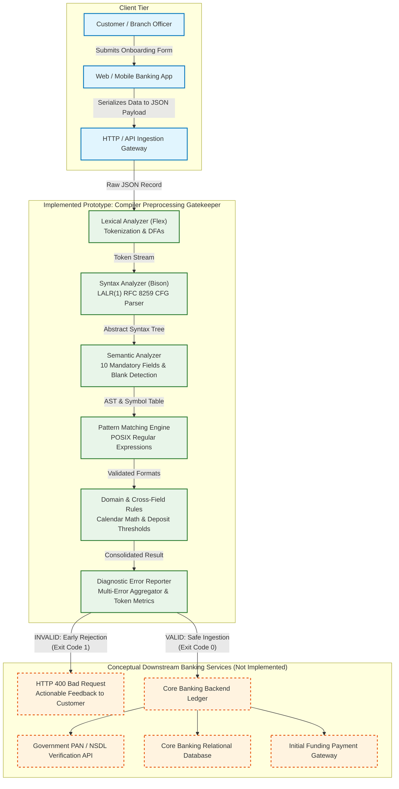
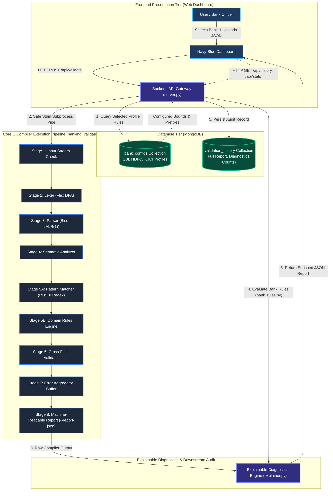
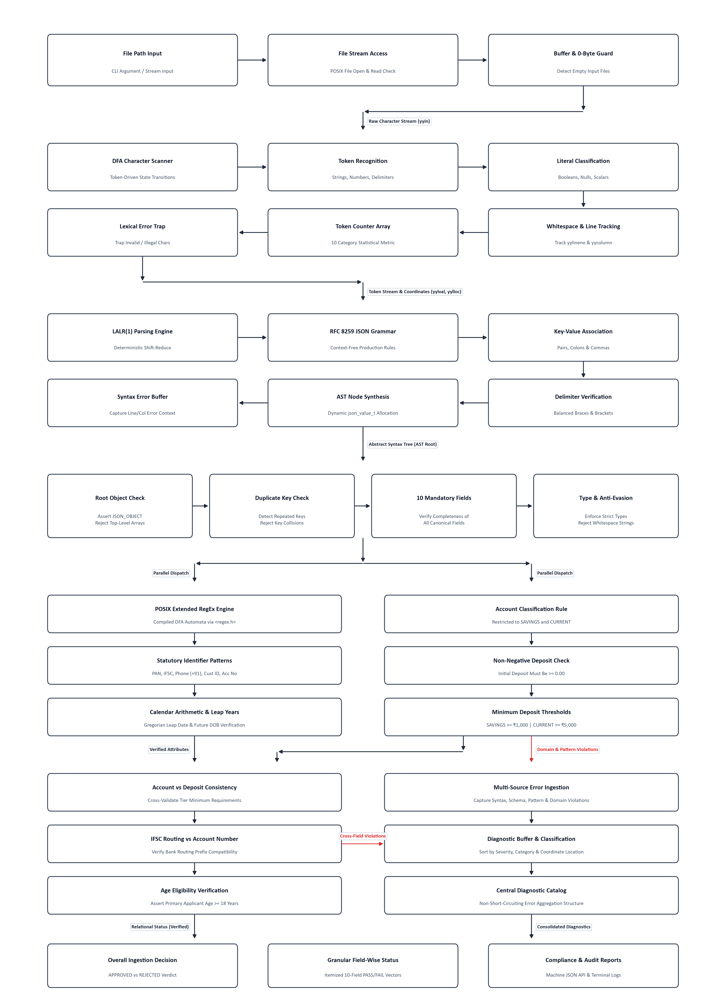

# Domain-Aware JSON Validation and Pattern Matching System for Banking Data

> **Project Status: Complete 8-Stage C Compiler Engine + MongoDB Integration + Configurable Bank Rules + Explainable Reports**  
> This compiler design project implements the complete 8-stage validation pipeline: JSON Banking Input Module, Lexical Analyzer (Flex with dynamic token metrics), Syntax Analyzer (Bison LALR(1) parser), Semantic Analyzer (10/10 required fields and type verification), Pattern Matching Engine (8 POSIX regular expressions), Domain Rule Engine (account types and minimum deposits), Cross-Field Validator, Multi-Stage Error Aggregator, and Final Validation Report (with both human-readable text and `--report-json` machine output), integrated with a modern local web interface.

A multi-stage, compiler-inspired validation system implemented in C using **Flex** and **Bison**. The system analyzes banking customer records formatted in JSON, performing lexical analysis, syntax parsing, semantic verification, regular-expression pattern matching, and domain constraint enforcement.

This project extends the faculty reference concept *"JSON File Syntax and Structure Analyzer with Pattern Matching"* into a robust, domain-aware compiler pipeline for banking account records.

---

## 1. Project Identity & Team Details

- **Project Title:** Domain-Aware JSON Validation and Pattern Matching System for Banking Data
- **Course:** Computer Science — Compiler Design (3rd Year)
- **Team Number:** 6
- **Team Members:**
  - **Ruthvik Reddy Thummala** — `24BAI0237`
  - **Abhinav MS** — `24BAI0218`
  - **V Vinay Karthik** — `24BCE0762`

---

## 2. Project Purpose & Objectives

In banking systems, data integrity requires multi-tier validation:
1. **Is the input structurally valid JSON?**
   - Grammatically sound JSON syntax according to RFC 8259 (braces, quotes, colons, commas, correct number syntax).
2. **Does the data satisfy banking domain requirements?**
   - Correct data types (e.g. numeric deposit, string account number to preserve leading zeroes).
   - Complete field presence without empty (`""`) or whitespace-only (`"   "`) values.
   - Pattern compliance for government identifiers, IFSC codes, phone numbers, and emails.
   - Calendar accuracy and temporal safety (no future dates of birth, leap year verification).
   - Domain rules and cross-field logic (account-type-dependent minimum initial deposits).

The system maintains a strict separation of concerns across compiler pipeline stages, clearly distinguishing between syntax errors, type mismatches, pattern failures, and domain-rule violations.

---

## 3. Real-World Application Scenario: Customer Onboarding & Account Opening

### 3.1 Overview & Architecture Placement

In modern digital banking (retail banking web portals, mobile banking applications, or branch teller systems), customer onboarding is a high-volume, mission-critical entry point. Before new customer records are persisted to immutable databases or submitted to expensive third-party verification networks (such as National ID/PAN verification, credit bureaus, or core banking ledgers), data must undergo **rigorous preprocessing and schema enforcement**.

This project serves as an **academic prototype of a high-performance, domain-aware compiler gatekeeper** positioned directly at the API ingestion boundary:



> [!NOTE]
> Detailed workflow documentation, sequence flows, and comprehensive stage breakdowns are detailed below in Section 4 and Section 5.

### 3.2 Ten-Step Account Opening Workflow

1. **User Data Entry:** A prospective customer completes an online savings or current account opening application via a web browser or mobile application.
2. **Payload Serialization:** The front-end application formats and serializes the form data into a structured JSON customer record.
3. **Gatekeeper Interception:** Before the payload can reach backend microservices, this compiler validator intercepts the request as an automated preprocessing filter.
4. **Lexical Analysis (Flex):** Character streams are converted into meaningful lexical tokens (strings, numbers, delimiters). Rejects invalid escape sequences and unclosed strings.
5. **Syntax Analysis (Bison):** The LALR(1) parser enforces context-free grammar constraints (RFC 8259). Rejects structural defects such as missing commas, unquoted keys, trailing commas, or mismatched braces.
6. **Semantic Analysis:** Checks that top-level data is a JSON object, verifies the presence of all 10 mandatory banking fields, and strictly rejects empty strings (`""`) and whitespace-only strings (`"   "`).
7. **Pattern Matching Engine:** Compiles and executes POSIX regular expressions to enforce regulatory standards:
   - Indian Income Tax PAN: 5 uppercase letters, 4 digits, 1 uppercase letter (`^[A-Z]{5}[0-9]{4}[A-Z]$`).
   - RBI IFSC Code: 4 uppercase letters, `0`, and 6 alphanumeric characters (`^[A-Z]{4}0[A-Z0-9]{6}$`).
   - Phone, Email, Customer ID, and 12-digit Account Number formats.
8. **Domain Rules Engine:** Enforces calendar mathematics (Gregorian leap-year computation for February 29th), verifies dates of birth are not in the future against the real-time system clock, and checks account types (`SAVINGS` vs `CURRENT`).
9. **Cross-Field Validation:** Inter-field business constraints are evaluated—verifying that the `initial_deposit` satisfies product minimums (₹1,000 for SAVINGS; ₹5,000 for CURRENT).
10. **Downstream Action & Routing:**
    - **If VALID (Exit 0):** The preprocessed record is guaranteed to be syntactically pristine, semantically complete, and domain-compliant. It is safely forwarded to core banking database persistence, identity verification (KYC/NSDL), and initial payment processing.
    - **If INVALID (Exit 1):** The record is immediately blocked. A structured diagnostic report containing exact line numbers, column coordinates, and remediation advice is returned to the user or bank operator.

### 3.3 Benefits of the Compiler-Design Approach

| Architectural Metric | Compiler Pipeline Approach (Our System) | Ad-Hoc / Naive Validation (Regex / If-Else scripts) |
|---|---|---|
| **Separation of Concerns** | Strict separation: Lexer $\to$ Parser $\to$ Semantics $\to$ Domain Rules | Monolithic spaghetti code mixing syntax parsing with business checks |
| **Error Diagnosis** | Precise line and column coordinates from token tracking | Vague "Invalid payload" or silent failure |
| **Fail-Fast Cost Savings** | Rejects malformed records in microseconds before expensive cloud services | Wasted API calls and billable roundtrips to government/KYC verification APIs |
| **Extensibility** | New grammar rules, tokens, or products added cleanly to grammar/rules modules | Fragile cascading conditionals requiring major refactoring |
| **Memory & Performance** | Native C compiled execution with zero overhead and minimal memory footprint | Slower interpreted runtime overhead |

### 3.4 Technical Scope & Disclaimers

> [!IMPORTANT]
> **Implementation Scope:** This project strictly implements the **compiler preprocessing, parsing, pattern-matching, semantic analysis, and domain validation pipeline** in C using Flex and Bison.
>
> **Conceptual Downstream Components:** Live bank core ledgers, external government API integrations (e.g., live NSDL/UIDAI verification), database persistence layers, and electronic payment gateways are **conceptual downstream systems** described to contextualize the real-world deployment of this compiler gatekeeper, but are not implemented within this academic prototype.

---

## 3.5 Upgraded Database-Backed Architecture & Configurable Bank Profiles

To bridge traditional compiler theory with realistic enterprise banking workflows, the system is upgraded with a **database-backed multi-tenant architecture**:



### Configurable Bank Demonstration Profiles in MongoDB

The `bank_configs` collection stores tenant-specific banking parameters that allow different financial institutions to enforce custom deposit bounds and branch routing rules on top of the C compiler base specification:

| Bank Code | Financial Institution | IFSC Prefix | SAVINGS Min. Deposit | CURRENT Min. Deposit | Mandatory Fields | Profile Designation |
|---|---|---|---|---|---|---|
| **SBI** | State Bank of India | `SBIN` | ₹3,000.00 | ₹10,000.00 | `pan_number` | Public Sector Demonstration Leader |
| **HDFC** | HDFC Bank | `HDFC` | ₹5,000.00 | ₹25,000.00 | `email` | Private Commercial Profile |
| **ICICI** | ICICI Bank | `ICIC` | ₹10,000.00 | ₹50,000.00 | `phone` | Premier Wealth Profile |

> **Demonstration Behavior:**  
> - A customer record with `initial_deposit: 2000.00` satisfies the C compiler baseline (`>= 1000`), but **fails** when evaluated under the **SBI profile** (which requires ₹3,000).
> - That same deposit of `3500.00` **passes** SBI, but **fails** under **HDFC** (which requires ₹5,000).
> - An initial deposit of `6000.00` **passes** both SBI and HDFC savings policies.

---

## 4. Compiler Design Concepts Demonstrated

| Phase | Tool / Mechanism | Concept Demonstrated |
|---|---|---|
| **Lexical Analysis** | Flex (`json_lexer.l`) | Tokenization, regular definitions, DFAs, line/column location tracking, string escape decoding, comment rejection, lexical token frequency statistics. |
| **Syntax Analysis** | Bison (`json_parser.y`) | Context-Free Grammars (CFG), LALR(1) shift-reduce parsing, AST building, grammar error detection (trailing commas, unquoted keys, mismatched delimiters). |
| **Intermediate Representation** | C AST (`json_value.h/c`) | Tree-based in-memory representation of JSON objects, arrays, primitives, and dynamic memory management. |
| **Semantic Analysis** | C (`semantic_analyzer.c`) | Mandatory schema verification, type inference/checking, duplicate key detection, unknown field warnings. |
| **Pattern Matching Engine** | POSIX Regex (`<regex.h>`) | NFA/DFA-based pattern matching on banking identifiers (PAN, IFSC, Account Number, Phone, Email, Customer ID). |
| **Domain & Cross-Field Rules** | C (`domain_rules.c`) | Multi-variable domain constraints, calendar mathematics (leap year algorithm), temporal comparisons against system time. |
| **Diagnostic Reporting** | C (`error_reporter.c`) | Aggregated error collection across independent fields without premature termination, stage execution tracking, human-readable diagnostics. |

---

## 5. Pipeline Architecture

<p align="center">
  
</p>
<p align="center"><em>Figure 1: Complete System Architecture of the Proposed Banking JSON Compiler Pipeline</em></p>

```text
                     +---------------------------------------+
                     |              JSON INPUT               |
                     +---------------------------------------+
                                         |
                                         v
                     +---------------------------------------+
                     |             INPUT HANDLER             |
                     | (File I/O, empty checks, interactive) |
                     +---------------------------------------+
                                         |
                                         v
                     +---------------------------------------+
                     |       LEXICAL ANALYZER (FLEX)         |
                     |  Tokens, Escapes, Column/Line Tracking|
                     +---------------------------------------+
                                         |
                                         v
                     +---------------------------------------+
                     |       SYNTAX ANALYZER (BISON)         |
                     |      LALR(1) Grammar, CFG Parser      |
                     +---------------------------------------+
                                         |
                                         v
                     +---------------------------------------+
                     |        JSON VALUE TREE (AST)          |
                     |   Objects, Arrays, Strings, Numbers   |
                     +---------------------------------------+
                                         |
                                         v
                     +---------------------------------------+
                     |           SEMANTIC ANALYZER           |
                     |  10 Mandatory Fields & Blank Detection|
                     +---------------------------------------+
                                         |
                        +----------------+----------------+
                        |                                 |
                        v                                 v
         +-----------------------------+   +-----------------------------+
         |   PATTERN MATCHING ENGINE   |   |     DOMAIN RULE ENGINE      |
         |  POSIX Regex (PAN, IFSC,    |   | Non-negative deposits, date |
         |   Phone, Email, CUS ID)     |   |   validity, allowed types   |
         +-----------------------------+   +-----------------------------+
                        |                                 |
                        +----------------+----------------+
                                         |
                                         v
                     +---------------------------------------+
                     |        CROSS-FIELD VALIDATION         |
                     |   (Deposit >= Minimum by Acct Type)   |
                     +---------------------------------------+
                                         |
                                         v
                     +---------------------------------------+
                     |       ERROR COLLECTION & REPORT       |
                     |    Categorized Diagnostics & Token    |
                     |             Frequency Table           |
                     +---------------------------------------+
                                         |
                                         v
                     +---------------------------------------+
                     |        FINAL VALIDATION REPORT        |
                     +---------------------------------------+
```

### 5.1 Multi-Error Validation & Independent Stage Flow

In real-world data preprocessing, aborting validation on the very first detected flaw is undesirable because clients or operators would need multiple submission cycles to discover all defects. Our pipeline incorporates an independent multi-stage error discovery flow:

1. **Safety Gatekeeper (Stages 1–4):**
   - Stage 1 (Input), Stage 2 (Lexer), and Stage 3 (Parser) establish that the JSON payload is structurally well-formed. If syntax errors occur (e.g. missing commas or unclosed braces), downstream AST traversal is safely bypassed (`NOT EXECUTED`), preventing null-pointer dereferences.
   - Stage 4 (Semantic Analyzer) verifies that all 10 mandatory fields are present, correctly typed, and non-empty.
2. **Independent Rule Evaluation (Stages 5A, 5B, 6):**
   - If Stage 5A (Pattern Matching) encounters an invalid pattern (e.g. `rahul.gmail.com` as email), it records the diagnostic in the Stage 7 error aggregator but **does not abort the pipeline**.
   - Stage 5B (Domain Rule Engine) proceeds independently, evaluating business constraints such as unsupported account types (e.g. `GOLD` or `BUSINESS`) and negative deposits (e.g. `-500.00`).
   - Stage 6 (Cross-Field Validation) evaluates inter-field rules (e.g. minimum balance and age eligibility) with defensive guards that suppress redundant cascaded errors when base fields are already invalid.
3. **Consolidated Stage 7 & 8 Reporting:**
   - All detected errors across stages are aggregated into the centralized diagnostic buffer.
   - Stage 8 renders the complete report—listing every violation with its exact stage, rule ID, field name, line/column coordinates, and readable remediation message.

---

---

## 6. Technology Stack

- **Core Compiler Language:** C (C99 standard, -Wall -Wextra -pedantic)
- **Lexical Analyzer Generator:** Flex (v2.6.4)
- **Parser Generator:** GNU Bison (v3.8.2)
- **Regular Expressions:** POSIX Regex (<regex.h>)
- **Build Automation:** GNU Make (v4.4.1)
- **Target OS Environments:** Linux, WSL (Ubuntu 20.04/22.04/24.04), macOS, MSYS2/MinGW on Windows.
- **Web Interface & Local Server:** Lightweight HTML5/CSS3/ES6 frontend served by Python 3 (http.server standard library, zero third-party dependencies).

---

## 7. Project Directory Layout

`	ext
CD_Banking_Project/
|-- Makefile                   # Build automation script
|-- .gitignore                 # Build artifacts exclusion
|-- README.md                  # Comprehensive project documentation
|-- server.py                  # Local Python standard library HTTP server
|-- banking_validator          # Compiled native executable (Stages 1–8)
|-- include/                   # Header files
|   |-- common.h               # Global constants, data types, tokens
|   |-- json_value.h           # AST node representations
|   |-- pattern_matcher.h      # POSIX regex engine signatures
|   |-- domain_rules.h         # Domain & calendar constraints
|   |-- semantic_analyzer.h    # Mandatory fields & type validation
|   |-- cross_field_validator.h# Cross-field business rules
|   |-- error_reporter.h       # Error collection & diagnostics catalog
|   -- validation_report.h    # Stage 8 text & JSON reports
|-- src/                       # C source code & grammar specs
|   |-- json_lexer.l           # Flex lexical specifications
|   |-- json_parser.y          # Bison LALR(1) grammar
|   |-- json_value.c           # AST construction & memory management
|   |-- pattern_matcher.c      # Pattern validation routines
|   |-- domain_rules.c         # Business & temporal checks
|   |-- semantic_analyzer.c    # Schema presence & type enforcement
|   |-- cross_field_validator.c# Inter-field validation
|   |-- error_reporter.c       # Diagnostic aggregation & deduplication
|   |-- validation_report.c    # Formatted final report generator
|   -- main.c                 # 8-Stage driver & CLI options
|-- web/                       # Presentation & testing web UI
|   |-- index.html             # Responsive dark-theme dashboard
|   |-- style.css              # Custom styling & components
|   -- app.js                 # Frontend API controller
|-- examples/                  # Valid & edge-case sample JSON records
-- tests/                     # Automated test harness & cases
    |-- test_runner.sh         # 79-test automated bash harness
    -- cases/                 # Individual isolated test cases
`

---

## 8. The Ten Core Banking Fields & Strict Validation Rules

The system enforces presence and strict type checks for exactly ten core fields:

| # | Field Name | Expected JSON Type | Required Format / Constraints |
|---|---|---|---|
| 1 | `customer_id` | String | Must match `^CUS[0-9]{4}$` (e.g. `CUS1025`) |
| 2 | `full_name` | String | Alphabetic letters and spaces only; non-empty |
| 3 | `email` | String | Conventional email pattern `^[A-Za-z0-9._%+-]+@[A-Za-z0-9.-]+\.[A-Za-z]{2,}$` |
| 4 | `phone` | String | Predefined Indian format: `^\+91-[0-9]{10}$` |
| 5 | `date_of_birth` | String | `YYYY-MM-DD`, valid calendar date, leap year aware, not in the future |
| 6 | `pan_number` | String | 5 uppercase letters, 4 digits, 1 uppercase letter (`^[A-Z]{5}[0-9]{4}[A-Z]$`) |
| 7 | `account_number` | String | Exactly 12 digits (`^[0-9]{12}$`). Preserved as string so leading zeroes aren't lost |
| 8 | `ifsc_code` | String | 4 uppercase letters, `0`, and 6 alphanumeric chars (`^[A-Z]{4}0[A-Z0-9]{6}$`) |
| 9 | `account_type` | String | Allowed values: `SAVINGS` or `CURRENT` (case-sensitive) |
| 10 | `initial_deposit` | Number | Must be a JSON Number $\ge 0.00$, and satisfy account type minimums |

### Strict Field Validation Semantics:
1. **Missing Fields:** If any of the 10 fields is absent from the JSON object, it is reported as `SEMANTIC ERROR (MISSING FIELD)` with status `MISSING`, immediately failing validation.
2. **Empty String Values (`""`):** If any required string field contains `""` (length 0), it is flagged as `SEMANTIC ERROR (BLANK FIELD): Field '<name>' cannot be empty.`, failing validation.
3. **Whitespace-Only String Values (`"   "`):** If any string field consists exclusively of spaces/tabs/newlines, it is flagged as `SEMANTIC ERROR (BLANK FIELD): Field '<name>' cannot be blank or contain only whitespace.`, failing validation.
4. **Numeric Representation of Deposit:** `initial_deposit` must be a true JSON Number. Empty strings `""`, whitespace-only strings `"   "`, numeric strings `"1500"`, or booleans are rejected as `TYPE ERROR`.
5. **Multi-Error Aggregated Reporting:** When multiple fields are missing, blank, or invalid, the semantic analyzer collects and reports **all detectable errors** in one unified diagnostic report without aborting after the first defect.

---

## 9. Pattern Matching & Domain Rules

### 9.1 Pattern Specifications
- **Customer ID:** Conceptual regex `^CUS[0-9]{4}$`. Rejects lowercase prefixes, wrong length, non-digits.
- **Full Name:** Letters and spaces only. Must contain at least one alphabetic letter. Rejects numbers, special symbols, and empty/whitespace-only entries.
- **Email:** Strict regex format validation checking username, `@`, domain label, and top-level domain.
- **Phone:** Exact format `+91-` followed by 10 numeric digits.
- **PAN Number:** Standard Indian Income Tax PAN format: 5 letters, 4 digits, 1 letter.
- **IFSC Code:** Standard Indian RBI IFSC format: 4 letters, `0` at index 4, 6 alphanumeric characters.
- **Account Number:** Preserved as a JSON string to protect leading zeroes. Validated to be exactly 12 numeric digits.

### 9.2 Calendar & Date Semantics
- Format regex: `^[0-9]{4}-[0-9]{2}-[0-9]{2}$`.
- **Month Validation:** 01 to 12.
- **Day Validation:** Validated against days per month (31 for Jan, Mar, May, Jul, Aug, Oct, Dec; 30 for Apr, Jun, Sep, Nov).
- **Leap Year Algorithm:**
  $$\text{is\_leap} = (\text{year} \pmod 4 = 0 \land \text{year} \pmod{100} \neq 0) \lor (\text{year} \pmod{400} = 0)$$
  February is permitted 29 days in leap years (e.g. `2000-02-29`), and restricted to 28 days in non-leap years (e.g. `2001-02-29` is rejected).
- **Temporal Future Check:** Compared against current system clock (`time(NULL)` and `localtime`). Birth dates cannot be in the future.

### 9.3 Domain & Cross-Field Rules
- **Non-negative Deposit:** Initial deposit must be $\ge 0.00$.
- **Cross-Field Account Constraints:**
  - If `account_type == "SAVINGS"`: $\text{initial\_deposit} \ge 1000.00$.
  - If `account_type == "CURRENT"`: $\text{initial\_deposit} \ge 5000.00$.
- **Duplicate Keys:** Multiple occurrences of the same key in the JSON object are detected and reported as a structural error.
- **Unknown Fields:** Fields outside the 10-field schema (e.g., `"metadata"`) are flagged as informative **Warnings** rather than failing the banking record.

---

## 10. Prerequisites & Installation

### Linux / WSL (Ubuntu/Debian)
Install GCC, Flex, Bison, and Make:
```bash
sudo apt update
sudo apt install -y build-essential flex bison python3
```

### Windows
The project can be run directly using **WSL (Windows Subsystem for Linux)**:
1. Open PowerShell in the project directory: `c:\Users\RUTHVIK REDDY.T\Desktop\CD_Banking_Project`
2. Run build and tests through WSL or PowerShell wrapper:
   ```powershell
   wsl make
   wsl make test
   ```

## 11. Build Instructions

The Makefile automates parser header generation, lexer compilation, and linking:

```bash
# Build the compiler executable
make

# Run the automated 56-test regression suite
make test

# Build with AddressSanitizer and UndefinedBehaviorSanitizer
make CFLAGS="-Wall -Wextra -std=c99 -pedantic -O2 -Iinclude -fsanitize=address,undefined" test

# Clean generated binaries, objects, and parser artifacts
make clean

# View available make targets
make help
```

## 12. Command-Line Workflow & JSON File Validation

The system operates strictly as a command-line Compiler Design application that reads a JSON customer record from a file (or standard input), runs the full lexical, syntactic, and semantic compiler pipeline, and outputs a structured validation report to the terminal.

### 12.1 Command Syntax
```bash
./banking_validator [options] <input_file.json>
```

On Windows with WSL:
```bash
wsl ./banking_validator examples/valid_customer.json
```

### 12.2 Command Options
- `-h`, `--help` : Show help information and options.
- `-v`, `--version` : Print project title, team members, and domain details.
- `-t`, `--tokens` : Display lexical token summary (enabled by default).
- `--no-tokens` : Suppress lexical token statistics table.
- `-i`, `--interactive` : Interactive mode from standard input (or pipe JSON via `cat file | ./banking_validator -`).

### 12.3 Creating and Validating Custom JSON Records

To validate a custom customer record:
1. Create a `.json` file (for example, `examples/my_customer.json`) containing the 10 mandatory fields:
```json
{
  "customer_id": "CUS1025",
  "full_name": "Priya Sharma",
  "email": "priya.sharma@example.com",
  "phone": "+91-9876543210",
  "date_of_birth": "1996-08-20",
  "pan_number": "ABCDE1234F",
  "account_number": "123456789012",
  "ifsc_code": "SBIN0001234",
  "account_type": "SAVINGS",
  "initial_deposit": 5000.00
}
```

2. Execute the validator from the terminal:
```bash
wsl ./banking_validator examples/my_customer.json
```

3. To validate via standard input piping:
```bash
cat examples/my_customer.json | wsl ./banking_validator -
```

### 12.3 Web Interface & Local HTTP Server Workflow

In addition to standard CLI execution, a lightweight local web interface is provided for presentation, live demonstration, and interactive testing.

`	ext
+-----------------------+        HTTP POST /api/validate         +------------------------+
|   Web Browser Form    | =====================================> |   Local Python Server  |
|  (HTML5 / CSS3 / JS)  | <===================================== |     (server.py)        |
+-----------------------+     JSON Validation Report Response    +------------------------+
                                                                             ||
                                                              Safe subprocess stdin/stdout
                                                              (banking_validator --report-json -)
                                                                             ||
                                                                             \/
                                                                 +------------------------+
                                                                 | C Compiler Executable  |
                                                                 | (Stages 1–8 Pipeline)  |
                                                                 +------------------------+
`

#### Starting the Web Server
Launch the server from the project root using standard Python 3:
`ash
python server.py
# Default: binds to 127.0.0.1:8080
`
Optional CLI flags:
`ash
python server.py --host 127.0.0.1 --port 8000
python server.py --test   # Runs automated compiler integration self-tests and exits
`

#### Opening in the Browser
Open your web browser and navigate to:
`
http://127.0.0.1:8080/
`

#### Key Capabilities of the Web Interface
1. **10 Mandatory Field Form:** Direct inputs with pattern hints for all banking fields.
2. **Account Type Flexibility:** Dropdown with SAVINGS and CURRENT, while allowing direct entry of invalid types like GOLD or BUSINESS.
3. **Preset Quick-Loaders:**
   - **Load Valid Sample:** Populates a fully compliant customer record.
   - **Load Invalid Sample (3 Errors):** Populates the multi-error record (
ahul.gmail.com, GOLD, -500.00).
   - **Preset Selector:** Quick-switch between edge cases (underage, leap-day birthdays, syntax errors).
4. **Raw JSON Editor Mode:** Toggle between visual form and raw JSON code editor. Direct compiler piping enables testing structural and syntax errors (missing commas, unbalanced braces) without browser-side pre-filtering.
5. **Real-Time Pipeline Breakdown:** Displays individual status badges (PASS, FAIL, NOT EXECUTED) across all Stages 1 through 8, clearly separating Stage 5A (Pattern) and Stage 5B (Domain).
6. **Detailed Diagnostics Catalog:** Highlights failed input fields in red, presents line and column coordinates, rule identifiers, and human-readable diagnostic advice.
7. **Zero Third-Party Dependencies:** Implemented using Python standard library http.server and native HTML5/CSS3/Vanilla JS. All validation logic executes inside the native C executable.

---

## 13. Example Commands & Outputs

### 13.1 Valid Banking Record
```bash
./banking_validator examples/valid_customer.json
```
Output:
```text
====================================================
       BANKING JSON VALIDATION REPORT
====================================================

Input File               : examples/valid_customer.json

Pipeline Execution Stages:
  JSON Structure         : VALID
  Lexical Analysis       : PASS
  Syntax Analysis        : PASS
  Required Fields        : 10/10 PRESENT
  Data Type Validation   : PASS
  Pattern Matching       : PASS
  Domain Rule Validation : PASS
  Cross-Field Validation : PASS

Lexical Token Summary:
  Strings ("...")        : 19
  Numbers                : 1
  Boolean Literals       : 0
  Null Literals          : 0
  Braces ('{' / '}')     : 1 / 1
  Brackets ('[' / ']')   : 0 / 0
  Colons (':')           : 10
  Commas (',')           : 9
  Total Meaningful Tokens: 41

Field Validation:
  customer_id            : PASS   
  full_name              : PASS   
  email                  : PASS   
  phone                  : PASS   
  date_of_birth          : PASS   
  pan_number             : PASS   
  account_number         : PASS   
  ifsc_code              : PASS   
  account_type           : PASS   
  initial_deposit        : PASS   

Summary:
  Errors   : 0
  Warnings : 0

FINAL RESULT: VALID BANKING DATA
====================================================
```
Exit code: `0`

---

### 13.2 Invalid JSON Syntax (Missing Comma)
```bash
./banking_validator examples/invalid_syntax.json
```
Output:
```text
====================================================
       BANKING JSON VALIDATION REPORT
====================================================

Input File               : examples/invalid_syntax.json

Pipeline Execution Stages:
  JSON Structure         : INVALID
  Lexical Analysis       : PASS
  Syntax Analysis        : FAIL
  Required Fields        : 0/10 PRESENT
  Data Type Validation   : NOT EXECUTED
  Pattern Matching       : NOT EXECUTED
  Domain Rule Validation : NOT EXECUTED
  Cross-Field Validation : NOT EXECUTED

Lexical Token Summary:
  Strings ("...")        : 5
  Numbers                : 0
  Boolean Literals       : 0
  Null Literals          : 0
  Braces ('{' / '}')     : 1 / 0
  Brackets ('[' / ']')   : 0 / 0
  Colons (':')           : 2
  Commas (',')           : 1
  Total Meaningful Tokens: 9

Errors (1):
   1. [SYNTAX ERROR] (Line 4, Col 3) syntax error, unexpected TOKEN_STRING, expecting } or ","

Summary:
  Errors   : 1
  Warnings : 0

FINAL RESULT: INVALID BANKING DATA
====================================================
```
Exit code: `1`

---

### 13.3 Missing Mandatory Field (`phone`)
```bash
./banking_validator examples/sample_missing_field.json
```
Output:
```text
====================================================
       BANKING JSON VALIDATION REPORT
====================================================

Input File               : examples/sample_missing_field.json

Pipeline Execution Stages:
  JSON Structure         : VALID
  Lexical Analysis       : PASS
  Syntax Analysis        : PASS
  Required Fields        : 9/10 PRESENT
  Data Type Validation   : PASS
  Pattern Matching       : PASS
  Domain Rule Validation : PASS
  Cross-Field Validation : PASS

Lexical Token Summary:
  Strings ("...")        : 17
  Numbers                : 1
  Boolean Literals       : 0
  Null Literals          : 0
  Braces ('{' / '}')     : 1 / 1
  Brackets ('[' / ']')   : 0 / 0
  Colons (':')           : 9
  Commas (',')           : 8
  Total Meaningful Tokens: 37

Field Validation:
  customer_id            : PASS   
  full_name              : PASS   
  email                  : PASS   
  phone                  : MISSING
  date_of_birth          : PASS   
  pan_number             : PASS   
  account_number         : PASS   
  ifsc_code              : PASS   
  account_type           : PASS   
  initial_deposit        : PASS   

Errors (1):
   1. [SEMANTIC ERROR (MISSING FIELD)] Field 'phone': Mandatory field 'phone' is missing.

Summary:
  Errors   : 1
  Warnings : 0

FINAL RESULT: INVALID BANKING DATA
====================================================
```
Exit code: `1`

---

### 13.4 Blank / Empty String Field (`full_name: ""`)
```bash
./banking_validator examples/sample_blank_field.json
```
Output:
```text
====================================================
       BANKING JSON VALIDATION REPORT
====================================================

Input File               : examples/sample_blank_field.json

Pipeline Execution Stages:
  JSON Structure         : VALID
  Lexical Analysis       : PASS
  Syntax Analysis        : PASS
  Required Fields        : 10/10 PRESENT
  Data Type Validation   : PASS
  Pattern Matching       : FAIL
  Domain Rule Validation : PASS
  Cross-Field Validation : PASS

Lexical Token Summary:
  Strings ("...")        : 19
  Numbers                : 1
  Boolean Literals       : 0
  Null Literals          : 0
  Braces ('{' / '}')     : 1 / 1
  Brackets ('[' / ']')   : 0 / 0
  Colons (':')           : 10
  Commas (',')           : 9
  Total Meaningful Tokens: 41

Field Validation:
  customer_id            : PASS   
  full_name              : FAIL    (Field 'full_name' cannot be empty.)
  email                  : PASS   
  phone                  : PASS   
  date_of_birth          : PASS   
  pan_number             : PASS   
  account_number         : PASS   
  ifsc_code              : PASS   
  account_type           : PASS   
  initial_deposit        : PASS   

Errors (1):
   1. [SEMANTIC ERROR (BLANK FIELD)] Field 'full_name': (Line 3, Col 16) Field 'full_name' cannot be empty.

Summary:
  Errors   : 1
  Warnings : 0

FINAL RESULT: INVALID BANKING DATA
====================================================
```
Exit code: `1`

---

### 13.5 Whitespace-Only Field (`full_name: "   "`)
```bash
./banking_validator examples/sample_whitespace_field.json
```
Output:
```text
====================================================
       BANKING JSON VALIDATION REPORT
====================================================

Input File               : examples/sample_whitespace_field.json

Pipeline Execution Stages:
  JSON Structure         : VALID
  Lexical Analysis       : PASS
  Syntax Analysis        : PASS
  Required Fields        : 10/10 PRESENT
  Data Type Validation   : PASS
  Pattern Matching       : FAIL
  Domain Rule Validation : PASS
  Cross-Field Validation : PASS

Lexical Token Summary:
  Strings ("...")        : 19
  Numbers                : 1
  Boolean Literals       : 0
  Null Literals          : 0
  Braces ('{' / '}')     : 1 / 1
  Brackets ('[' / ']')   : 0 / 0
  Colons (':')           : 10
  Commas (',')           : 9
  Total Meaningful Tokens: 41

Field Validation:
  customer_id            : PASS   
  full_name              : FAIL    (Field 'full_name' cannot be blank or contain only whitespace.)
  email                  : PASS   
  phone                  : PASS   
  date_of_birth          : PASS   
  pan_number             : PASS   
  account_number         : PASS   
  ifsc_code              : PASS   
  account_type           : PASS   
  initial_deposit        : PASS   

Errors (1):
   1. [SEMANTIC ERROR (BLANK FIELD)] Field 'full_name': (Line 3, Col 16) Field 'full_name' cannot be blank or contain only whitespace.

Summary:
  Errors   : 1
  Warnings : 0

FINAL RESULT: INVALID BANKING DATA
====================================================
```
Exit code: `1`

---

### 13.6 Multiple Blank & Invalid Fields Aggregated Report
```bash
./banking_validator examples/sample_multiple_blank_fields.json
```
Output:
```text
====================================================
       BANKING JSON VALIDATION REPORT
====================================================

Input File               : examples/sample_multiple_blank_fields.json

Pipeline Execution Stages:
  JSON Structure         : VALID
  Lexical Analysis       : PASS
  Syntax Analysis        : PASS
  Required Fields        : 10/10 PRESENT
  Data Type Validation   : FAIL
  Pattern Matching       : FAIL
  Domain Rule Validation : PASS
  Cross-Field Validation : PASS

Lexical Token Summary:
  Strings ("...")        : 20
  Numbers                : 0
  Boolean Literals       : 0
  Null Literals          : 0
  Braces ('{' / '}')     : 1 / 1
  Brackets ('[' / ']')   : 0 / 0
  Colons (':')           : 10
  Commas (',')           : 9
  Total Meaningful Tokens: 41

Field Validation:
  customer_id            : FAIL    (Field 'customer_id' cannot be empty.)
  full_name              : FAIL    (Field 'full_name' cannot be blank or contain only whitespace.)
  email                  : FAIL    (Field 'email' cannot be empty.)
  phone                  : FAIL    (Field 'phone' cannot be blank or contain only whitespace.)
  date_of_birth          : FAIL    (Field 'date_of_birth' cannot be empty.)
  pan_number             : FAIL    (Field 'pan_number' cannot be blank or contain only whitespace.)
  account_number         : FAIL    (Field 'account_number' cannot be empty.)
  ifsc_code              : FAIL    (Field 'ifsc_code' cannot be blank or contain only whitespace.)
  account_type           : FAIL    (Field 'account_type' cannot be empty.)
  initial_deposit        : FAIL    (Type mismatch (expected Number))

Errors (10):
   1. [SEMANTIC ERROR (BLANK FIELD)] Field 'customer_id': (Line 2, Col 18) Field 'customer_id' cannot be empty.
   2. [SEMANTIC ERROR (BLANK FIELD)] Field 'full_name': (Line 3, Col 16) Field 'full_name' cannot be blank or contain only whitespace.
   3. [SEMANTIC ERROR (BLANK FIELD)] Field 'email': (Line 4, Col 12) Field 'email' cannot be empty.
   4. [SEMANTIC ERROR (BLANK FIELD)] Field 'phone': (Line 5, Col 12) Field 'phone' cannot be blank or contain only whitespace.
   5. [SEMANTIC ERROR (BLANK FIELD)] Field 'date_of_birth': (Line 6, Col 20) Field 'date_of_birth' cannot be empty.
   6. [SEMANTIC ERROR (BLANK FIELD)] Field 'pan_number': (Line 7, Col 17) Field 'pan_number' cannot be blank or contain only whitespace.
   7. [SEMANTIC ERROR (BLANK FIELD)] Field 'account_number': (Line 8, Col 21) Field 'account_number' cannot be empty.
   8. [SEMANTIC ERROR (BLANK FIELD)] Field 'ifsc_code': (Line 9, Col 16) Field 'ifsc_code' cannot be blank or contain only whitespace.
   9. [SEMANTIC ERROR (BLANK FIELD)] Field 'account_type': (Line 10, Col 19) Field 'account_type' cannot be empty.
  10. [TYPE ERROR] Field 'initial_deposit': (Line 11, Col 22) Field 'initial_deposit' expected JSON Number, but found whitespace-only String.

Summary:
  Errors   : 10
  Warnings : 0

FINAL RESULT: INVALID BANKING DATA
====================================================
```
Exit code: `1`

---

## 14. Automated Test Suite

The test suite runs **61 automated compiler regression tests** exercising all functional aspects of the Stages 1–5B compiler pipeline:

```bash
make test
```

### 14.1 Test Suite Breakdown

| Section | Tests | Target Scope & Verification Purpose | Result |
|---|---|---|---|
| **Section 1: Core Grammar & Domain Rules** | 01–20 | RFC 8259 syntax, regex patterns, leap year math, duplicate keys, unknown field warnings, nested JSON structures. | **20/20 PASS** |
| **Section 2: Missing Field Permutations** | 21–30 | Individual omission of each of the 10 core fields (`customer_id`, `full_name`, `email`, `phone`, `date_of_birth`, `pan_number`, `account_number`, `ifsc_code`, `account_type`, `initial_deposit`). | **10/10 PASS** |
| **Section 3: Empty String (`""`) Semantics** | 31–39 | Individual verification that all 9 string fields are strictly rejected when set to empty string `""`. | **9/9 PASS** |
| **Section 4: Whitespace-Only (`"   "`) Semantics** | 40–48 | Individual verification that all 9 string fields are strictly rejected when populated solely with spaces or tabs. | **9/9 PASS** |
| **Section 5: Initial Deposit Type Enforcement** | 49–51 | Numeric string (`"25000"`), empty string (`""`), and whitespace string (`"   "`) rejected as Type Errors for `initial_deposit`. | **3/3 PASS** |
| **Section 6: Multiple Blanks & Structural Edges** | 52–56 | Multiple blanks aggregation (10 simultaneous errors), empty file (0 bytes), empty JSON object (`{}`), trailing comma rejection, top-level array rejection. | **5/5 PASS** |
| **Section 7: Milestone Boundary & Thresholds** | 57–61 | SAVINGS exact minimum (₹1,000.00), CURRENT exact minimum (₹5,000.00), CURRENT above minimum (₹6,500.50), multiple independent pattern failures, missing input file handling. | **5/5 PASS** |

### 14.2 Detailed Test Case Matrix

| Test # | Test Description | Input File | Expected Outcome | Result |
|---|---|---|---|---|
| **Test 01** | Valid JSON & valid banking record | `examples/valid_customer.json` | Exit 0, PASS | **PASS** |
| **Test 02** | Invalid JSON syntax (missing comma) | `examples/invalid_syntax.json` | Exit 1, SYNTAX ERROR | **PASS** |
| **Test 03** | Invalid email pattern | `examples/test_invalid_email.json` | Exit 1, PATTERN ERROR | **PASS** |
| **Test 04** | Invalid phone pattern (missing +91-) | `examples/test_invalid_phone.json` | Exit 1, PATTERN ERROR | **PASS** |
| **Test 05** | Invalid PAN pattern | `examples/test_invalid_pan.json` | Exit 1, PATTERN ERROR | **PASS** |
| **Test 06** | Invalid IFSC code pattern | `examples/test_invalid_ifsc.json` | Exit 1, PATTERN ERROR | **PASS** |
| **Test 07** | Invalid Customer ID pattern | `examples/test_invalid_cusid.json` | Exit 1, PATTERN ERROR | **PASS** |
| **Test 08** | Invalid account number length | `examples/test_invalid_accno.json` | Exit 1, PATTERN ERROR | **PASS** |
| **Test 09** | Missing mandatory field (phone) | `examples/missing_fields.json` | Exit 1, MISSING FIELD | **PASS** |
| **Test 10** | Wrong JSON data type for deposit | `examples/test_wrong_type.json` | Exit 1, TYPE ERROR | **PASS** |
| **Test 11** | Invalid account type ('BUSINESS') | `examples/test_invalid_acctype.json` | Exit 1, DOMAIN ERROR | **PASS** |
| **Test 12** | Negative initial deposit | `examples/test_negative_deposit.json` | Exit 1, DOMAIN ERROR | **PASS** |
| **Test 13** | SAVINGS deposit below 1000 minimum | `examples/edge_savings_below_min.json` | Exit 1, DOMAIN ERROR | **PASS** |
| **Test 14** | CURRENT deposit below 5000 minimum | `examples/edge_current_below_min.json` | Exit 1, DOMAIN ERROR | **PASS** |
| **Test 15** | Future date of birth rejection | `examples/test_future_dob.json` | Exit 1, DOMAIN ERROR | **PASS** |
| **Test 16** | Invalid calendar date (Feb 29 non-leap) | `examples/edge_invalid_leap_date.json` | Exit 1, DOMAIN ERROR | **PASS** |
| **Test 17** | Valid leap year date (Feb 29 leap 2000) | `examples/edge_valid_leap_date.json` | Exit 0, PASS | **PASS** |
| **Test 18** | Duplicate key detection in JSON object | `examples/edge_duplicate_key.json` | Exit 1, STRUCTURAL ERROR | **PASS** |
| **Test 19** | Unknown field warning (metadata) | `examples/nested_json.json` | Exit 0, WARN emitted | **PASS** |
| **Test 20** | Nested JSON objects & arrays support | `examples/nested_json.json` | Exit 0, PASS | **PASS** |
| **Test 21** | Missing field: `customer_id` | `tests/cases/missing_customer_id.json` | Exit 1, MISSING FIELD | **PASS** |
| **Test 22** | Missing field: `full_name` | `tests/cases/missing_full_name.json` | Exit 1, MISSING FIELD | **PASS** |
| **Test 23** | Missing field: `email` | `tests/cases/missing_email.json` | Exit 1, MISSING FIELD | **PASS** |
| **Test 24** | Missing field: `phone` | `tests/cases/missing_phone.json` | Exit 1, MISSING FIELD | **PASS** |
| **Test 25** | Missing field: `date_of_birth` | `tests/cases/missing_date_of_birth.json` | Exit 1, MISSING FIELD | **PASS** |
| **Test 26** | Missing field: `pan_number` | `tests/cases/missing_pan_number.json` | Exit 1, MISSING FIELD | **PASS** |
| **Test 27** | Missing field: `account_number` | `tests/cases/missing_account_number.json` | Exit 1, MISSING FIELD | **PASS** |
| **Test 28** | Missing field: `ifsc_code` | `tests/cases/missing_ifsc_code.json` | Exit 1, MISSING FIELD | **PASS** |
| **Test 29** | Missing field: `account_type` | `tests/cases/missing_account_type.json` | Exit 1, MISSING FIELD | **PASS** |
| **Test 30** | Missing field: `initial_deposit` | `tests/cases/missing_initial_deposit.json` | Exit 1, MISSING FIELD | **PASS** |
| **Test 31** | Empty string: `customer_id` | `tests/cases/empty_customer_id.json` | Exit 1, BLANK FIELD | **PASS** |
| **Test 32** | Empty string: `full_name` | `tests/cases/empty_full_name.json` | Exit 1, BLANK FIELD | **PASS** |
| **Test 33** | Empty string: `email` | `tests/cases/empty_email.json` | Exit 1, BLANK FIELD | **PASS** |
| **Test 34** | Empty string: `phone` | `tests/cases/empty_phone.json` | Exit 1, BLANK FIELD | **PASS** |
| **Test 35** | Empty string: `date_of_birth` | `tests/cases/empty_date_of_birth.json` | Exit 1, BLANK FIELD | **PASS** |
| **Test 36** | Empty string: `pan_number` | `tests/cases/empty_pan_number.json` | Exit 1, BLANK FIELD | **PASS** |
| **Test 37** | Empty string: `account_number` | `tests/cases/empty_account_number.json` | Exit 1, BLANK FIELD | **PASS** |
| **Test 38** | Empty string: `ifsc_code` | `tests/cases/empty_ifsc_code.json` | Exit 1, BLANK FIELD | **PASS** |
| **Test 39** | Empty string: `account_type` | `tests/cases/empty_account_type.json` | Exit 1, BLANK FIELD | **PASS** |
| **Test 40** | Whitespace string: `customer_id` | `tests/cases/whitespace_customer_id.json` | Exit 1, BLANK FIELD | **PASS** |
| **Test 41** | Whitespace string: `full_name` | `tests/cases/whitespace_full_name.json` | Exit 1, BLANK FIELD | **PASS** |
| **Test 42** | Whitespace string: `email` | `tests/cases/whitespace_email.json` | Exit 1, BLANK FIELD | **PASS** |
| **Test 43** | Whitespace string: `phone` | `tests/cases/whitespace_phone.json` | Exit 1, BLANK FIELD | **PASS** |
| **Test 44** | Whitespace string: `date_of_birth` | `tests/cases/whitespace_date_of_birth.json` | Exit 1, BLANK FIELD | **PASS** |
| **Test 45** | Whitespace string: `pan_number` | `tests/cases/whitespace_pan_number.json` | Exit 1, BLANK FIELD | **PASS** |
| **Test 46** | Whitespace string: `account_number` | `tests/cases/whitespace_account_number.json` | Exit 1, BLANK FIELD | **PASS** |
| **Test 47** | Whitespace string: `ifsc_code` | `tests/cases/whitespace_ifsc_code.json` | Exit 1, BLANK FIELD | **PASS** |
| **Test 48** | Whitespace string: `account_type` | `tests/cases/whitespace_account_type.json` | Exit 1, BLANK FIELD | **PASS** |
| **Test 49** | Deposit as numeric string | `tests/cases/deposit_string_number.json` | Exit 1, TYPE ERROR | **PASS** |
| **Test 50** | Deposit as empty string | `tests/cases/deposit_empty_string.json` | Exit 1, TYPE ERROR | **PASS** |
| **Test 51** | Deposit as whitespace string | `tests/cases/deposit_whitespace_string.json` | Exit 1, TYPE ERROR | **PASS** |
| **Test 52** | Multiple blanks in single record | `tests/cases/multiple_blank_fields.json` | Exit 1, 10 ERRORS | **PASS** |
| **Test 53** | Empty input file (0 bytes) | `examples/edge_empty.json` | Exit 1, SYNTAX/EMPTY | **PASS** |
| **Test 54** | Empty JSON object (`{}`) | `examples/edge_empty_object.json` | Exit 1, MISSING FIELDS | **PASS** |
| **Test 55** | Trailing comma syntax error | `examples/edge_trailing_comma.json` | Exit 1, SYNTAX ERROR | **PASS** |
| **Test 56** | Top-level array instead of object | `examples/edge_top_level_array.json` | Exit 1, TYPE ERROR | **PASS** |
| **Test 57** | SAVINGS deposit at exact minimum (1000.00) | `examples/edge_savings_exact_min.json` | Exit 0, PASS | **PASS** |
| **Test 58** | CURRENT deposit at exact minimum (5000.00) | `examples/edge_current_exact_min.json` | Exit 0, PASS | **PASS** |
| **Test 59** | CURRENT deposit above minimum (6500.50) | `examples/edge_current_valid.json` | Exit 0, PASS | **PASS** |
| **Test 60** | Multiple independent pattern failures | `examples/invalid_patterns.json` | Exit 1, PATTERN FAIL | **PASS** |
| **Test 61** | Missing input file (non-existent path) | `examples/non_existent_file.json` | Exit 1, FILE ERROR | **PASS** |

| **Test 62** | Stage 6: Valid cross-field combination | 	ests/cases/stage6_valid_cross_field.json | Exit 0, PASS | **PASS** |
| **Test 63** | Stage 6: Underage applicant (below 18 years) | 	ests/cases/stage6_underage.json | Exit 1, CROSS-FIELD ERROR | **PASS** |
| **Test 64** | Stage 6: Age eligibility boundary (age >= 18) | 	ests/cases/stage6_exact_age_18.json | Exit 0, PASS | **PASS** |
| **Test 65** | Stage 6: Leap-day birthday customer (Feb 29) | 	ests/cases/stage6_leap_day_birthday.json | Exit 0, PASS | **PASS** |
| **Test 66** | Stage 6: Unknown bank prefix handled safely | 	ests/cases/stage6_unknown_bank_safe.json | Exit 0, PASS | **PASS** |
| **Test 67** | Stage 6: Dummy sequence account number | 	ests/cases/stage6_dummy_account_sequence.json | Exit 0, PASS (Warning) | **PASS** |
| **Test 68** | Stage 6: Account/deposit inconsistency (CURRENT) | 	ests/cases/stage6_account_deposit_mismatch.json | Exit 1, CROSS-FIELD ERROR | **PASS** |
| **Test 69** | Stage 7: Multi-stage error collection buffer | 	ests/cases/stage7_multi_error.json | Exit 1, MULTI-ERROR BUFFER | **PASS** |
| **Test 70** | Stage 7: Syntax failure blocks AST execution | 	ests/cases/stage7_syntax_blocks_ast.json | Exit 1, SYNTAX SAFETY | **PASS** |
| **Test 71** | Stage 7: Missing fields safe memory handling | 	ests/cases/stage7_missing_fields_safe.json | Exit 1, MISSING SAFETY | **PASS** |
| **Test 72** | Stage 7: Clean diagnostic catalog on valid data | examples/valid_customer.json | Exit 0, CLEAN CATALOG | **PASS** |
| **Test 73** | Stage 7: Multi-stage independent errors (3 errors) | examples/test_three_errors.json | Exit 1, 3 ERRORS RECORDED | **PASS** |
| **Test 74** | Stage 8: Complete report verified valid | examples/valid_customer.json | Exit 0, REPORT VALID | **PASS** |
| **Test 75** | Stage 8: Warning-only maintains validity | 	ests/cases/stage8_warning_only.json | Exit 0, REPORT VALID | **PASS** |
| **Test 76** | Stage 8: Machine-readable JSON on valid record | examples/valid_customer.json | Exit 0, JSON PARSED | **PASS** |
| **Test 77** | Stage 8: Machine-readable JSON on syntax fail | examples/invalid_syntax.json | Exit 1, JSON PARSED | **PASS** |
| **Test 78** | Stage 8: Machine-readable JSON on underage | 	ests/cases/stage6_underage.json | Exit 1, JSON PARSED | **PASS** |
| **Test 79** | Stage 8: Machine-readable JSON on 3 errors | examples/test_three_errors.json | Exit 1, JSON 3 ERRORS | **PASS** |

**Summary: 79 / 79 Tests Passed (100% Success Rate, 0 Failed).**

### 14.3 Memory Safety & Sanitizer Verification
The full 56-test regression suite was executed under **AddressSanitizer (ASan)** and **UndefinedBehaviorSanitizer (UBSan)**:
```bash
make CFLAGS="-Wall -Wextra -std=c99 -pedantic -O2 -Iinclude -fsanitize=address,undefined" test
```
**Results:**
- **Memory Leaks:** 0
- **Use-After-Free / Buffer Overflows:** 0
- **Undefined Behavior Warnings:** 0
- **Centralized AST Memory Management:** Verified leak-free on both valid ASTs and syntax error unwinding.

---

## 15. Assumptions & Known Limitations

1. **Academic Scope & Preprocessing Role:** This project implements the compiler preprocessing and structural validation pipeline in C using Flex and Bison. It validates syntactic formats, patterns, and structural integrity before data reaches core systems. It intentionally does not connect to live banking networks or government verification APIs.
2. **Simplified Name Rules:** `full_name` is verified to contain alphabetic characters and spaces only. Complex international Unicode names or punctuation marks (hyphens, apostrophes) are excluded by design to keep lexical rules clean and predictable.
3. **Account Types & Thresholds:** The minimum deposit rules (₹1,000 for SAVINGS, ₹5,000 for CURRENT) and allowed account types (`SAVINGS`, `CURRENT`) are project-defined assumptions demonstrating cross-field semantic validation.
4. **Number Precision:** Numbers are parsed into double-precision floating point representations and comparisons apply floating-point epsilon tolerances (`1e-9`) to avoid truncation and precision loss.


## 16. Quickstart & Demonstration Commands

### 16.1 Prerequisites
- **GCC / Clang:** C99 compiler
- **Flex:** Fast Lexical Analyzer (v2.6+)
- **Bison:** LALR(1) Parser Generator (v3.8+)
- **Python:** 3.10+ (Standard library + PyMongo)
- **MongoDB:** Community Server (v5.0+ running on `mongodb://localhost:27017`)

### 16.2 Setup & Execution in 4 Steps

```bash
# 1. Install PyMongo driver
pip install pymongo

# 2. Seed demonstration bank profiles (SBI, HDFC, ICICI) into MongoDB
python seed_db.py

# 3. Compile the C executable using Makefile
make clean && make

# 4. Launch the local web platform and API server
python server.py --port 8080
```
Open **`http://localhost:8080`** in any modern web browser to access the interactive banking dashboard.

### 16.3 Automated Test Execution
```bash
# Run the 79-test C compiler test harness (Stages 1 to 8)
make test

# Run the 5-suite Python/MongoDB integration test harness
python test_upgrade.py

# Run backend self-test mode
python server.py --test
```

---

## 17. Backend API Reference

The lightweight Python application server (`server.py`) uses exclusively Python's standard library (`http.server`, `subprocess`, `json`) to safely orchestrate the compiled C compiler and serve the web UI:

| Endpoint | Method | Content-Type | Description | Sample Request / Response |
|---|---|---|---|---|
| `/` or `/index.html` | `GET` | `text/html` | Serves the responsive web interface dashboard | Interactive Web GUI |
| `/style.css` | `GET` | `text/css` | Frontend CSS styling and visual components | Stylesheet asset |
| `/app.js` | `GET` | `application/javascript` | Frontend client-side controller and REST handler | Javascript application |
| `/api/health` | `GET` | `application/json` | System health status, platform info, and compiler command | `{"status": "healthy", "compiler_command": [...]}` |
| `/api/samples` | `GET` | `application/json` | Catalog of preset customer demonstration records | Returns all sample JSON records |
| `/api/samples/{key}` | `GET` | `application/json` | Retrieve a specific sample (`valid`, `invalid_multi`, etc.) | Returns JSON payload object |
| `/api/validate` | `POST` | `application/json` | Executes the 8-stage C compiler pipeline via safe stdin pipe | Input: JSON customer record<br>Output: Full machine-readable audit report |

---

## 18. Google Colab Demonstration Guide

For faculty demonstrations or cloud evaluation without a local C development environment, an interactive, fully configured Jupyter notebook is provided:

📁 **[`Domain_Aware_JSON_Banking_Validator_Colab.ipynb`](Domain_Aware_JSON_Banking_Validator_Colab.ipynb)**

### How to Run in Google Colab:
1. Open [Google Colab](https://colab.research.google.com/).
2. Select the **Upload** tab and upload `Domain_Aware_JSON_Banking_Validator_Colab.ipynb`.
3. Follow the numbered cells in the notebook:
   - **Environment Setup:** Automatically installs `gcc`, `flex`, `bison`, and `make`.
   - **Repository Extraction:** Clones or unpacks the project source tree.
   - **Compilation:** Executes `make clean && make` to build the `banking_validator` native binary.
   - **Automated Regression Suite:** Runs all 79 automated test cases.
   - **Interactive Demonstrations:** Runs the validator across valid records, multi-error payloads, syntax errors, and edge cases with explainable terminal and JSON reports.

---

## 19. Online Cloud Deployment Guide (Render)

This project includes a production-ready **`Dockerfile`** and **`render.yaml`** blueprint for instant, zero-configuration deployment to [Render](https://render.com) (or any Docker-compatible PaaS such as Railway, Fly.io, or Google Cloud Run).

### Quick Deployment Steps on Render:
1. Push this repository to GitHub: `https://github.com/ruthvikk-reddy/Banking-JSON-Compiler-Validator`.
2. Sign in to your [Render Dashboard](https://dashboard.render.com/).
3. Click **New +** $
ightarrow$ **Web Service**.
4. Connect your GitHub account and select the **`Banking-JSON-Compiler-Validator`** repository.
5. Render will automatically detect the **`Dockerfile`**:
   - **Language / Runtime:** Docker
   - **Branch:** `main`
   - **Plan:** Free
   - **Region:** Oregon (US West) or closest region
6. Click **Create Web Service**.
7. Render automatically:
   - Provisions a Linux container (`python:3.11-slim`).
   - Installs `gcc`, `flex`, `bison`, and `make`.
   - Executes `make clean && make` to compile `banking_validator`.
   - Runs `python server.py --test` to verify pipeline integrity.
   - Binds to `0.0.0.0:$PORT` and provisions a free, secure public HTTPS URL (e.g. `https://banking-json-compiler-validator.onrender.com`).

---

## 20. Viva Voce Preparation Guide (10 Review Questions & Answers)

This section provides clear, technically grounded answers tailored for 3rd-year Computer Science laboratory reviews and viva examinations.

### Q1: What does the compiler in this project actually do?
**Answer:** The compiler serves as an automated syntactic and domain-validation gatekeeper for banking records. It ingests customer data formatted as JSON, parses it through an 8-stage pipeline—tokenizing it with a Flex lexical scanner, verifying context-free grammar with a Bison LALR(1) parser, checking types and field presence during semantic analysis, validating formats against POSIX regular expressions, and verifying domain logic (such as calendar leap-year mathematics and deposit minimums)—and emits a structured audit decision without crashing or truncating errors.

### Q2: Why are Flex and Bison used instead of standard library JSON parsers like Python's `json` or C's `cJSON`?
**Answer:** Standard JSON libraries are designed solely to decode valid JSON into key-value dictionaries. When a syntax error occurs (such as an unquoted key or trailing comma), they immediately abort with a generic exception and provide zero domain insight. Using Flex and Bison allows us to:
1. Demonstrate fundamental compiler construction techniques (DFAs, tokens, Context-Free Grammars, shift-reduce conflicts).
2. Maintain precise line and column location coordinates via `@$` and `yylloc`.
3. Construct a custom Abstract Syntax Tree (AST) that tracks field types and detects duplicate keys.
4. Keep the parsing phase strictly decoupled from domain business logic.

### Q3: What specific checks does the Pattern Matching Engine (Stage 5A) perform?
**Answer:** The pattern matching engine enforces regulatory and banking string formats using POSIX Extended Regular Expressions (`regcomp` and `regexec`):
- **PAN Number:** `^[A-Z]{5}[0-9]{4}[A-Z]$` (5 uppercase letters, 4 digits, 1 uppercase letter).
- **IFSC Code:** `^[A-Z]{4}0[A-Z0-9]{6}$` (4 letters, '0', 6 alphanumeric characters).
- **Phone Number:** `^\+91-[6-9][0-9]{9}$` (Indian E.164 mobile prefix with 10 digits).
- **Email:** `^[a-zA-Z0-9._%+-]+@[a-zA-Z0-9.-]+\.[a-zA-Z]{2,}$` (RFC 5322 compliant structure).
- **Customer ID:** `^CUS[0-9]{4}$` (`CUS` prefix followed by 4 numeric digits).
- **Account Number:** `^[0-9]{9,18}$` (Standard banking account length bounds).

### Q4: What does Cross-Field Validation (Stage 6) check, and why can't it be handled in earlier stages?
**Answer:** Cross-field validation evaluates inter-dependencies between two or more distinct attributes. These cannot be evaluated during lexical or syntactic phases because tokenizers and context-free parsers only understand one token or production at a time without contextual meaning. Stage 6 checks:
1. **Age vs. Application Date:** Calculates exact chronological age between `date_of_birth` and the real-time system clock to enforce the legal adulthood threshold ($\ge 18$ years).
2. **Account Type vs. Minimum Deposit:** Ensures `initial_deposit` satisfies product minimums (₹1,000 for `SAVINGS`, ₹5,000 for `CURRENT`).
3. **Account Number Sequence Sanity:** Rejects trivial dummy sequences (such as `123456789` or repeating identical digits).

### Q5: Why is MongoDB integrated into this Compiler Design project?
**Answer:** MongoDB is used to demonstrate **multi-tenant extensibility and persistent audit compliance**:
1. It decouples bank-specific policies from the compiled C binary. Instead of hardcoding bank rules in C source code, demonstration profiles (SBI, HDFC, ICICI) are stored in the `bank_configs` collection and can be modified dynamically.
2. It stores a complete, immutable audit trail of every validation run in `validation_history`, recording timestamps, audit decisions, error counts, and passed/failed checks so previous submissions can be reviewed or reopened at any time.

### Q6: How does the selected bank's database configuration affect validation?
**Answer:** When a user selects a bank (e.g. SBI vs HDFC), the backend queries MongoDB for that bank's active rules. The C compiler first validates universal baseline rules. Then, the database-driven rules layer evaluates bank-specific policies:
- For **SBI**, savings accounts require at least **₹3,000.00** and IFSC codes must begin with **`SBIN`**.
- For **HDFC**, savings accounts require at least **₹5,000.00** and IFSC codes must begin with **`HDFC`**.
- For **ICICI**, savings accounts require at least **₹10,000.00** and IFSC codes must begin with **`ICIC`**.
Thus, a deposit of ₹3,500 is approved under SBI but rejected under HDFC!

### Q7: How does the backend invoke the C executable safely?
**Answer:** The backend uses Python's `subprocess.run` with **fixed argument arrays and direct stdin/stdout piping**:
```python
cmd = ["./banking_validator", "--report-json", "-"]
process = subprocess.run(cmd, input=json_payload, capture_output=True, text=True, timeout=10)
```
- **Security:** User-supplied JSON is fed strictly through the standard input pipe (`stdin`), eliminating command-line argument injection, shell metacharacter expansion, and directory traversal vulnerabilities.
- **Safety:** A 10-second timeout prevents infinite loops, and return codes distinguish between syntax/validation failures (exit 1) and server crashes.

### Q8: How do raw compiler errors become structured, explainable frontend reports?
**Answer:** The C compiler's Stage 8 emits structured JSON containing diagnostic objects with `stage`, `severity`, `rule_id`, `field`, `line`, `col`, and `message`. The Python explainer module (`explainer.py`) matches each `rule_id` against an explainability catalog and enriches it with:
1. **Affected Field:** Explicit attribute name.
2. **Rule Checked:** Human-readable regulatory rule title.
3. **Detection Stage:** Exactly which compiler phase or database rule caught the issue.
4. **Plain-English Explanation:** Clear description of why the data violated the rule.
5. **Actionable Correction Suggestion:** Concrete advice on how to rectify the input.

### Q9: How is validation history stored and retrieved?
**Answer:** Every completed validation produces an audit document inserted into MongoDB's `validation_history` collection using PyMongo. The document records the selected bank, submission timestamp in UTC ISO format, overall status (`VALID` or `INVALID`), error and warning counts, passed checks count, and the complete diagnostic breakdown. The frontend queries `GET /api/history` to display the chronological audit table, and `GET /api/history/{id}` retrieves the full report by its unique MongoDB `ObjectId`.

### Q10: What makes this project different from a generic JSON schema validator?
**Answer:** Generic JSON schema validators (like AJV or `jsonschema`) only verify primitive types and static regex patterns against a schema. They lack:
1. **Calendar Mathematics & Temporal Verification:** Genuine Gregorian leap-year validation (e.g. verifying February 29th against leap century rules) and chronological age calculations against the real-time clock.
2. **Compiler-Grade Multi-Stage Diagnostics:** Clear stage-by-stage isolation (Lexer $	o$ Parser $	o$ Semantics $	o$ Patterns $	o$ Domain $	o$ Cross-Field) with precise token coordinate tracking.
3. **Explainable Remediations:** Contextual plain-English suggestions rather than cryptic "schema validation failed" errors.
4. **Multi-Tenant Database Configuration:** Configurable bank-specific thresholds dynamically loaded from MongoDB without recompiling or redeploying code.

---

